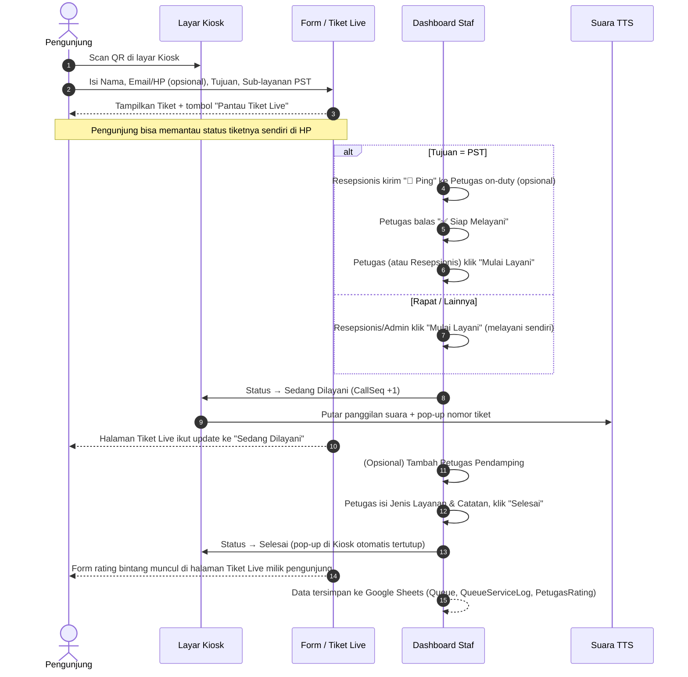

# 🏛️ Sistem Antrian & Buku Tamu Digital PST — BPS
### Edisi Google Apps Script + Google Sheets · v4.0

Aplikasi Manajemen Antrian dan Buku Tamu Digital **Pelayanan Statistik Terpadu (PST)** untuk satu kantor BPS (saat ini dikonfigurasi untuk **BPS Provinsi Lampung**), dibangun sepenuhnya di atas **Google Apps Script** dengan **Google Sheets** sebagai database. Tidak butuh server terpisah, database eksternal, atau proses build — cukup satu proyek Apps Script (5 berkas: `Code.gs`, `Kiosk.html`, `Form.html`, `Dashboard.html`, `Tiket.html`) yang di-deploy sebagai Web App.

> ℹ️ Dokumen ini adalah referensi teknis untuk kode yang **benar-benar berjalan**, bukan rencana produk. Untuk perbandingan dengan rencana awal (arsitektur Next.js/Prisma multi-tenant) dan daftar kebutuhan fungsional lengkap, lihat [`PRD.md`](./PRD.md).

**✨ Sorotan fitur:** pendaftaran mandiri via QR dengan pelacakan tiket live untuk pengunjung · panggilan suara otomatis + pop-up bisa ditutup manual di Kiosk · penilaian bintang dari 3 kanal (Kiosk, Tiket Live, Dashboard) yang bisa ditujukan ke petugas manapun · notifikasi Ping/Ready antara Resepsionis dan Petugas · toggle Mode Bertugas mandiri · kolaborasi multi-petugas per tiket · sinkronisasi Master Pegawai dari Wawai API (kredensial otomatis dari NIP) · template Excel siap-isi untuk roster bulanan maupun rotasi harian · rekap & ekspor Excel.

---

## 📑 Daftar Isi
- [Fitur Berdasarkan Role](#-fitur-berdasarkan-role)
- [Flow & Alur Kerja](#-flow--alur-kerja)
- [Penomoran Antrian & Kategori Layanan](#-penomoran-antrian--kategori-layanan)
- [Tech Stack](#-tech-stack)
- [Struktur Halaman (Routing via Query Parameter)](#-struktur-halaman-routing-via-query-parameter)
- [Struktur Data (Google Sheets)](#-struktur-data-google-sheets)
- [Panduan Instalasi & Deployment](#-panduan-instalasi--deployment)
- [Sinkronisasi Master Pegawai dari Wawai API](#-sinkronisasi-master-pegawai-dari-wawai-api)
- [Akun Default / Testing](#-akun-default--testing)
- [Keterbatasan Diketahui](#-keterbatasan-diketahui)

---

## 🎯 Fitur Berdasarkan Role

```
+-----------------------------------------------------------------------------------+
|                    SISTEM ANTRIAN PST BPS — GOOGLE APPS SCRIPT                    |
+-----------------------------------------------------------------------------------+
|  1. PENGUNJUNG     | Form Buku Tamu, Tiket Live, Panggilan Suara, Rating Mandiri   |
|  2. RESEPSIONIS    | Lihat Antrian, Ping Petugas, Tugaskan Petugas, Jadwal Harian  |
|  3. PETUGAS PST    | Mode Bertugas, Terima Ping, Mulai/Selesaikan Layanan, Pendamping |
|  4. ADMIN SATKER   | Master Pegawai, Sinkron Wawai API, Jadwal, Rekap, Ekspor Excel |
|  5. SUPERADMIN     | Sama seperti Admin (satu kantor — belum ada beda hak akses)   |
+-----------------------------------------------------------------------------------+
```

### 1. 🌐 Pengunjung (Publik — Tanpa Login)
- **Layar Kiosk (`?page=kiosk`):** Menampilkan nama kantor, jam real-time, QR code besar untuk pendaftaran mandiri (URL otomatis mengikuti deployment aktif via `getAppUrl()`), daftar petugas yang bertugas hari ini, daftar antrian menunggu, dan 5 antrian terakhir yang selesai. Auto-refresh antrian setiap **5 detik**, daftar petugas setiap **30 detik**.
- **Form Pendaftaran (`?page=form`):** Diakses dengan memindai QR di layar Kiosk. Mengisi Nama, **Email & No. HP (opsional)**, Tujuan Kunjungan (PST / Rapat-Kerjasama / Keperluan Lainnya), sub-layanan PST (A–Perpustakaan, B–Konsultasi Statistik, C–Produk Statistik Berbayar, D–Rekomendasi Statistik) jika PST, keperluan/detail (opsional), Instansi/Alamat (opsional), dan jumlah pengunjung (1–50).
- **Tiket Digital + QR:** Setelah submit, sistem menampilkan nomor tiket (mis. `B-001`) beserta QR code, ditampilkan langsung di layar HP pengunjung.
- **🔴 Pantau Tiket Live (`?page=tiket&id=...`):** Halaman yang bisa dibuka lewat tombol di tiket — menampilkan status tiket (Menunggu/Sedang Dilayani/Selesai) yang **auto-refresh tiap 5 detik**, estimasi jumlah antrian di depan & estimasi menit tunggu (kategori sama, 10 menit/antrian).
- **Panggilan Suara Otomatis:** Saat statusnya berubah menjadi "Sedang Dilayani", layar Kiosk menampilkan pop-up besar dan memutar suara panggilan Bahasa Indonesia (via Travis TTS API, dengan fallback otomatis ke Web Speech API browser). Pop-up ini punya tombol ✕ untuk ditutup manual kapan saja (otomatis menghentikan suara yang sedang diputar).
- **⭐ Penilaian dari 3 Kanal:** Begitu status tiket jadi **Selesai**, rating bintang 1–5 + komentar bisa diisi lewat: (1) **halaman Tiket Live** di HP yang dipakai daftar, (2) **layar Kiosk** — muncul pop-up rating otomatis untuk tiket yang baru saja selesai (≤3 menit), bisa dipakai siapa pun yang masih ada di dekat kiosk, atau (3) **Dashboard petugas** (staf mengisikan atas nama pengunjung). Rating hanya perlu diisi lewat salah satu kanal — begitu tersimpan, kanal lain otomatis menampilkan status "sudah dinilai".
- **Penilaian bisa ditujukan ke petugas manapun**, bukan cuma yang otomatis tercatat di tiket — pilihannya mencakup petugas yang tercatat di tiket, petugas pendamping (kalau ada kolaborasi), dan seluruh petugas yang sedang bertugas hari ini. Berlaku untuk semua jenis kunjungan (PST maupun Rapat/Lainnya), tidak dibatasi hanya PST.

### 2. 👩‍💼 Resepsionis
- Melihat panel **"👥 Bertugas Sekarang"** di bagian atas tab Antrian — daftar real-time petugas yang jadwalnya aktif hari ini DAN Mode Bertugas-nya menyala, supaya langsung tahu siapa yang bisa ditugaskan/di-ping tanpa perlu membuka modal.
- Melihat daftar antrian hari ini beserta status & statistik ringkas (Menunggu/Dilayani/Selesai), termasuk kontak (No. HP/Email) pengunjung bila diisi.
- Untuk tiket bertujuan **PST**, bisa langsung "Mulai Layani" (memilih petugas on-duty untuk mulai melayani sekarang), **atau** menekan **"📣 Ping"** untuk sekadar memberi tahu petugas yang dipilih bahwa ada tamu menunggu — petugas menerima pop-up di dashboardnya dan membalas **"✅ Saya Siap Melayani"**, lalu Resepsionis mendapat notifikasi toast begitu petugas siap (polling setiap ±4 detik).
- Untuk tiket **Rapat/Kerjasama** atau **Keperluan Lainnya**, dapat langsung "Mulai Layani" dan melayani sendiri tanpa memilih petugas — dan tetap bisa **menunjuk petugas PST tertentu untuk menerima rating** lewat dropdown "Dinilai untuk petugas" saat mengisikan penilaian, bukan otomatis dikreditkan ke nama Resepsionis sendiri.
- Mengatur **Jadwal Harian**: memilih dari roster bulanan siapa yang benar-benar bertugas pada tanggal tertentu, via kalender interaktif, form tanggal satu-per-satu, **atau impor Excel satu bulan sekaligus** (lihat poin Admin di bawah — fitur ini juga bisa diakses Resepsionis).

### 3. 🧑‍💻 Petugas PST
- Melihat panel **"👋 Status Saya Hari Ini"** — ringkasan Mode Bertugas (aktif/non-aktif/tidak terjadwal) dan jumlah pengunjung yang sudah dilayani hari ini, tanpa perlu menghitung manual dari daftar antrian.
- **🔘 Mode Bertugas:** Toggle mandiri di pojok atas dashboard — petugas yang terjadwal (roster bulanan + Jadwal Harian) dapat menandai dirinya "Sedang Bertugas" atau "Non-Aktif Sementara" (mis. sedang rapat/istirahat) tanpa perlu Resepsionis mengubah Jadwal Harian. Hanya yang aktif yang muncul di panel "Bertugas Sekarang" dan sebagai opsi penugasan.
- Menerima **pop-up Ping** dari Resepsionis (dipoll otomatis tiap ±4 detik) dan membalas "Saya Siap Melayani" satu klik.
- Hanya bisa menekan **"Mulai Layani"** jika namanya ada di roster bulanan periode berjalan, dipilih on-duty pada Jadwal Harian, **dan** Mode Bertugas sedang aktif.
- **Mulai Layani** → status jadi "Sedang Dilayani", waktu mulai dicatat, memicu panggilan suara+pop-up di Kiosk.
- **🤝 Tambah Petugas Pendamping:** untuk tiket yang sedang dilayani, dapat mencatat petugas lain (dari daftar on-duty) yang ikut membantu — ditampilkan sebagai chip kolaborator pada kartu antrian, dan ikut muncul sebagai pilihan saat pengunjung/staf memberi rating.
- **Selesai** → mengisi Jenis Layanan (A–D) & Catatan Pelayanan, status jadi "Selesai", waktu selesai dicatat, lalu modal penilaian bintang bisa dibuka (opsional — pengunjung bisa menilai sendiri lewat Kiosk atau Tiket Live).
- **Panggil Ulang** untuk tiket yang sedang dilayani (memicu ulang suara tanpa mengubah status).
- Mengubah nama/username/password sendiri di tab **Profil Saya**.

### 4. 🏛️ Admin Satker (dan Superadmin — lihat catatan di bawah)
- **Master Pegawai:** Cari, tambah, dan edit data pegawai (Nama, Username, Password, Role, Status Aktif).
- **🔄 Sinkronisasi Data Pegawai (Wawai API):** Menarik data pegawai terbaru langsung dari API resmi Wawai (`wawai.statapps.dev`) dan menggabungkannya ke Master Pegawai — pegawai baru ditambahkan otomatis dengan **Role default `PEGAWAI`** (netral, belum bisa memproses antrian) dan kredensial login **email `{NIP Lama}@bps.go.id` + password 8 digit pertama NIP Baru** (lihat [bagian tersendiri](#-sinkronisasi-master-pegawai-dari-wawai-api) di bawah). Admin perlu **mengedit Role** pegawai yang relevan menjadi `PETUGAS`/`RESEPSIONIS` lewat tab Master Pegawai sebelum mereka bisa dijadwalkan & memproses antrian.
- **Jadwal Bulanan:** Memilih periode (bulan), lalu memilih maksimal **3 Petugas** + **1 Resepsionis** dari Master Pegawai (dengan kotak pencarian) sebagai roster bulan tersebut.
- **Impor Jadwal Bulanan dari Excel:** Klik **"⬇️ Unduh Template Excel"** untuk mendapatkan berkas `.xlsx` yang sudah otomatis terisi Periode + daftar nama & username seluruh pegawai ber-Role `PETUGAS`/`RESEPSIONIS` dari Master Pegawai (jadi tidak perlu mengetik nama dari nol / risiko typo). Admin tinggal mengisi kolom Role ("PETUGAS"/"RESEPSIONIS") untuk pegawai yang bertugas periode tsb dan membiarkan sisanya kosong — baris berkolom Role kosong otomatis **dilewati** saat diunggah kembali lewat "Proses & Simpan".
- **Impor Rotasi Harian dari Excel (satu bulan sekaligus):** Di bagian Jadwal Harian, klik **"⬇️ Unduh Template Excel"** untuk mendapatkan berkas berisi *seluruh tanggal* bulan yang sedang ditampilkan di Kalender Rotasi × petugas roster bulanan (format: Tanggal, Nama, Username). Hapus baris untuk kombinasi yang tidak berlaku, sisakan yang bertugas, lalu unggah lewat **"Proses & Simpan Satu Bulan"** — tersimpan sekaligus untuk semua tanggal dalam satu panggilan server (`saveJadwalHarianBulk`), jadi tidak perlu mengatur satu-per-satu lewat kalender atau form tanggal manual.
- **Kalender Rotasi Petugas:** Tampilan kalender bulanan; klik tanggal untuk langsung mengatur petugas on-duty hari itu.
- **Rekap & Insight:** Total kunjungan hari ini, rata-rata waktu tunggu & waktu layanan (menit), distribusi jenis layanan hari ini (bar chart CSS), tren 7 hari terakhir, 5 petugas teratas hari ini, dan daftar rating+komentar hari ini.
- **⬇️ Ekspor ke Excel:** Mengunduh seluruh data Rekap & Insight hari ini (ringkasan, distribusi layanan, tren 7 hari, top petugas, daftar rating) sebagai satu berkas `.xlsx` multi-sheet, dibuat langsung di browser dengan SheetJS.

> **Catatan Role:** Pada implementasi ini, `ADMIN` dan `SUPERADMIN` memiliki hak akses UI yang **identik** (lihat fungsi `setupUIForRole` di `Dashboard.html`), karena sistem hanya melayani satu kantor. Manajemen multi-kantor dan admin lintas satker tetap di luar cakupan saat ini (lihat `PRD.md`).

---

## 🔄 Flow & Alur Kerja



---

## 🔢 Penomoran Antrian & Kategori Layanan

Nomor tiket dibuat otomatis **per prefix** dan **direset setiap hari** (berdasarkan tanggal Asia/Jakarta):

| Prefix | Kategori Layanan | Tipe Tujuan |
| :---: | :--- | :--- |
| **`A`** | Perpustakaan | PST |
| **`B`** | Konsultasi Statistik | PST |
| **`C`** | Produk Statistik Berbayar | PST |
| **`D`** | Rekomendasi Statistik | PST |
| **`U`** | Umum — mencakup **Rapat/Kerjasama** dan **Keperluan Lainnya** sekaligus | Non-PST |

*Format tiket: `[Prefix]-[Nomor Urut 3 digit]`, contoh: `A-001`, `B-012`, `U-003`.*

Counter disimpan di sheet **Config** sebagai `COUNTER_<PREFIX>` dan `COUNTER_DATE_<PREFIX>`, dan otomatis di-reset ke `0` saat tanggal berganti.

---

## 💻 Tech Stack

- **Runtime & Backend:** Google Apps Script (V8 runtime), fungsi server dipanggil dari klien via `google.script.run`
- **Database:** Google Sheets (via `SpreadsheetApp`) — tanpa ORM, tanpa migrasi skema formal
- **Frontend:** `HtmlService` (template Kiosk.html, Form.html, Dashboard.html, Tiket.html) + vanilla JavaScript, tanpa framework
- **Integrasi Eksternal:** `UrlFetchApp` untuk menarik data dari Wawai API; `PropertiesService` sebagai tempat opsional menyimpan API key secara aman (lihat bagian Wawai di bawah)
- **Impor/Ekspor Excel:** SheetJS (`xlsx.full.min.js`) dimuat dari CDN, diproses langsung di browser (impor Jadwal Bulanan & ekspor Rekap)
- **QR Code:** API publik `api.qrserver.com`
- **Text-to-Speech:** Travis TTS API (`travis-tts.statapps.dev`) sebagai suara utama, dengan fallback otomatis ke `SpeechSynthesis` (Web Speech API) bila API eksternal gagal/offline
- **Notifikasi Ping/Ready & Live Tracking:** Polling `google.script.run` (bukan websocket — Apps Script tidak mendukungnya): Kiosk 5–30 detik, Dashboard 10 detik (antrian) / 4 detik (ping), halaman Tiket Live 5 detik

---

## 🗺️ Struktur Halaman (Routing via Query Parameter)

Karena berbasis Apps Script Web App, routing dilakukan lewat `doGet(e)` dan parameter `?page=`, bukan rute URL Next.js:

| URL | Hak Akses | Deskripsi |
| :--- | :--- | :--- |
| `?page=kiosk` (default) | Publik | Layar display kantor: antrian, petugas bertugas, QR pendaftaran, panggilan suara |
| `?page=form` | Publik | Form Buku Tamu Digital & pengambilan tiket |
| `?page=tiket&id=<entryId>` | Publik (tautan per-tiket) | Pelacakan tiket live + estimasi antrian + form rating mandiri |
| `?page=dashboard` | Login staf | Login + dashboard tab (Antrian, Master Pegawai, Jadwal, Rekap, Profil) sesuai role, dalam satu halaman |

*Tidak ada rute publik multi-tenant (`/o/[kodeKantor]`) maupun sub-rute dashboard per fitur — semua diatur lewat tab di dalam satu halaman Dashboard.*

---

## 🗄️ Struktur Data (Google Sheets)

Tidak ada database relasional — seluruh data disimpan di sheet-sheet berikut dalam satu Spreadsheet (`SPREADSHEET_ID`):

| Sheet | Kolom Utama | Fungsi |
| :--- | :--- | :--- |
| **Queue** | ID, Ticket, Prefix, Number, NamaPengunjung, Tujuan, Detail, InstansiAlamat, JumlahOrang, Status, Petugas, ServiceType, ServiceDetail, Rating, RatingComment, Timestamp, Tanggal, CallSeq, MulaiLayanTimestamp, SelesaiTimestamp, **Email, NoHP** | Data antrian & buku tamu harian |
| **Config** | Key, Value | Nama/kode kantor, counter nomor tiket per prefix |
| **Users** | ID, Nama, Username, Password, Role, IsActive | Akun staf (login, tanpa hashing password) |
| **JadwalBulanan** | ID, Periode, PegawaiID, Nama, Role, IsActive | Roster bulanan (maks. 3 Petugas + 1 Resepsionis) |
| **JadwalHarian** | ID, Tanggal, PegawaiID, Nama, DipilihOleh, Timestamp, **IsDutyModeOn** | Siapa yang on-duty tanggal tsb + status toggle Mode Bertugas |
| **PetugasRating** | ID, EntryID, PetugasNama, Score, Comment, Tanggal | Rekap rating per petugas per tiket |
| **PingNotification** | ID, EntryID, EntryTicket, VisitorName, FromNama, ToPetugasID, ToPetugasNama, Status, CreatedAt, RespondedAt | Riwayat Ping Resepsionis→Petugas dan balasan Ready |
| **QueueServiceLog** | ID, EntryID, PetugasID, PetugasNama, PeranLog, Timestamp | Petugas pendamping (multi-petugas) per tiket |

---

## ⚙️ Panduan Instalasi & Deployment

Tidak perlu `npm install`, `.env`, atau migrasi database — cukup Google Workspace/Akun Google biasa.

1. **Siapkan Spreadsheet:** Buat Google Spreadsheet baru, salin `SPREADSHEET_ID` dari URL-nya (`https://docs.google.com/spreadsheets/d/[SPREADSHEET_ID]/edit`).
2. **Buat Proyek Apps Script:** Dari spreadsheet → *Extensions* → *Apps Script*. Buat 5 berkas: `Code.gs`, `Kiosk.html`, `Form.html`, `Dashboard.html`, `Tiket.html`, lalu tempel isi masing-masing.
3. **Set konfigurasi:** Isi `SPREADSHEET_ID` di baris atas `Code.gs` dengan ID dari langkah 1.
4. **Inisialisasi data:** Jalankan fungsi `setupAllPegawaiData()` (atau alias `setupDummyData()`) satu kali dari editor Apps Script (tombol *Run*). Ini akan membuat seluruh sheet, mengisi ±300 data pegawai contoh, akun staf default, dan antrian dummy hari ini. Berikan izin akses yang diminta Google.
5. **Deploy sebagai Web App:** *Deploy* → *New deployment* → tipe *Web app*. Isi *Execute as: Me*, *Who has access: Anyone* (atau dibatasi sesuai kebutuhan). Salin URL deployment yang dihasilkan.
6. **Akses aplikasi:**
   - `[URL]?page=kiosk` → tampilkan di TV/monitor kantor (QR pendaftaran otomatis mengikuti URL deployment ini, tidak perlu diedit manual)
   - `[URL]?page=form` → bisa di-scan via QR di Kiosk, atau dibagikan langsung
   - `[URL]?page=dashboard` → login staf (Petugas/Resepsionis/Admin/Superadmin)

---

## 🔗 Sinkronisasi Master Pegawai dari Wawai API

Admin/Superadmin dapat menekan tombol **"🔄 Sinkronisasi Data Pegawai (Wawai API)"** di tab Master Pegawai untuk menarik data pegawai terbaru dari API resmi:

```
GET https://wawai.statapps.dev/api/public/pegawai?api_key=<API_KEY>
```

Respons berbentuk `{ success, total, raw_data: [{ nama, nip_baru, nip_lama, satker, golongan, nama_jabatan, ... }] }`. Fungsi `syncPegawaiFromWawai()` di `Code.gs` mencocokkan tiap pegawai berdasarkan **NIP**: yang sudah ada diperbarui namanya, yang baru ditambahkan dengan **Role `PEGAWAI`** (bukan langsung `PETUGAS` — karena data Wawai mencakup seluruh jabatan lintas bidang, misalnya Pranata Komputer, Analis Anggaran, hingga Kepala Satker, bukan cuma yang bertugas di loket PST). Kredensial login pegawai baru dibuat otomatis dari NIP:
- **Email/Username:** `{NIP Lama}@bps.go.id`
- **Password:** 8 digit pertama dari **NIP Baru**

Pegawai yang salah satu NIP-nya kosong tetap masuk ke Master Pegawai tapi dilewati pembuatan akunnya (dihitung sebagai "tidak lengkap" di pesan hasil). **Akun yang sudah dipakai login tidak pernah ditimpa** (dilewati kalau email/username-nya bentrok dengan akun non-hasil-sinkron), dan password TIDAK diperbarui ulang pada sinkronisasi berikutnya (aman kalau pegawai sudah menggantinya sendiri).

Setelah sinkronisasi, **Admin perlu meninjau daftar pegawai baru** (Role = PEGAWAI) di tab Master Pegawai dan mengedit Role-nya menjadi `PETUGAS` atau `RESEPSIONIS` untuk pegawai yang memang akan bertugas di PST — baru setelah itu mereka bisa dimasukkan ke Jadwal Bulanan dan memproses antrian. Selama masih ber-Role `PEGAWAI`, akun tersebut tetap bisa login (melihat tab Antrian & Profil), tapi semua tombol aksi antrian (Mulai Layani, Selesai, dsb.) disembunyikan dan diganti catatan bahwa Role-nya perlu diubah dulu.

> ⚠️ **Keamanan API key.** URL di atas menyertakan API key secara langsung. Karena `Code.gs` berjalan di server (bukan di browser), key ini tidak pernah terlihat pengunjung — tapi tetap ikut ter-commit kalau berkas ini diunggah ke repo publik atau dibagikan ke orang yang tidak seharusnya memilikinya. Sebelum membagikan project ini, jalankan sekali dari editor Apps Script:
> ```js
> setWawaiApiUrl("https://wawai.statapps.dev/api/public/pegawai?api_key=...")
> ```
> Ini menyimpan URL+key di **Script Properties** (bukan di source code), lalu kosongkan/ganti nilai `WAWAI_API_URL_DEFAULT` di `Code.gs` sebelum dibagikan.

---

## 🔑 Akun Default / Testing

Dihasilkan otomatis oleh `setupAllPegawaiData()`:

| Email / Username | Role | Password Default |
| :--- | :--- | :--- |
| `superadmin` | SUPERADMIN | `superadmin` |
| `admin` | ADMIN | `admin123` |
| `resepsionis` | RESEPSIONIS | `bps2025` |
| *(±300 pegawai contoh dari seed manual, mis. `ahlul.karom`, `dewi.wahyuningsih`)* | PETUGAS | `bps2025` |
| *(pegawai hasil Sinkronisasi Wawai API)* | PEGAWAI | lihat di bawah |

**Login pegawai hasil Sinkronisasi Wawai API** memakai skema berbeda dari seed manual:
- **Email/Username:** `{NIP Lama}@bps.go.id`
- **Password:** 8 digit pertama dari **NIP Baru**

Kedua NIP (lama & baru) wajib ada pada data Wawai API agar akun tersebut bisa dibuatkan kredensial — kalau salah satu kosong, pegawai itu tetap masuk ke Master Pegawai namun dilewati saat pembuatan akun login (dihitung terpisah sebagai "tidak lengkap" di pesan hasil sinkronisasi). Password ini **tidak pernah ditimpa ulang** oleh sinkronisasi berikutnya, supaya aman kalau pegawai sudah menggantinya sendiri lewat tab Profil Saya.

*Username pegawai seed manual dibuat otomatis dari nama (huruf kecil, dipisah titik, tanpa gelar) — skema ini berbeda dari pegawai hasil sinkronisasi Wawai API yang memakai email NIP.*

---

## 🚧 Keterbatasan Diketahui

- Password disimpan & dibandingkan sebagai teks biasa di sheet Users (tidak di-hash).
- Tidak ada sesi/token login — status login hanya disimpan di memori browser (variabel JS), refresh halaman = logout.
- Real-time bersifat *polling*, bukan push/websocket (lihat interval di bagian Tech Stack).
- Satu kantor per deployment (tidak multi-tenant); untuk kantor lain perlu deployment + Spreadsheet terpisah. Field `satker` dari Wawai API belum dipakai untuk memfilter per-kantor — sinkronisasi menarik seluruh data yang dikembalikan API.
- Fungsi `getPetugasRatingSummary()` (rekap rating per petugas sepanjang waktu) sudah tersedia di backend namun **belum** dipanggil dari UI manapun saat ini.

Untuk daftar perbandingan lengkap terhadap rencana produk awal, lihat [`PRD.md`](./PRD.md) bagian **"Perbedaan dari Visi Awal"**.

---

**Sistem Antrian & Buku Tamu Digital PST BPS** — Edisi Google Apps Script v4.0
Hak Cipta © Badan Pusat Statistik (BPS).
